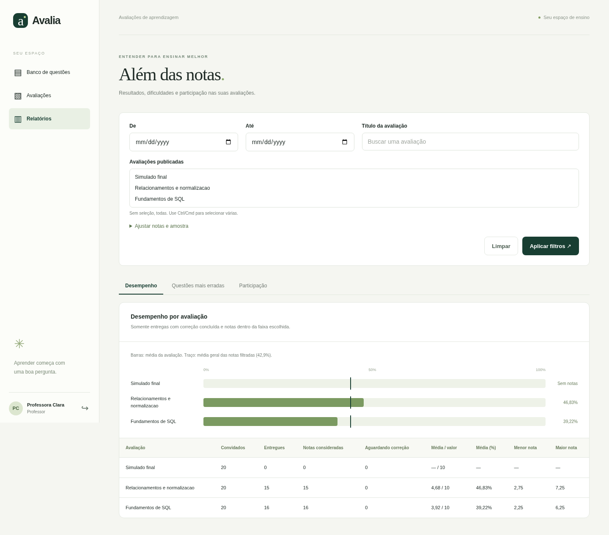
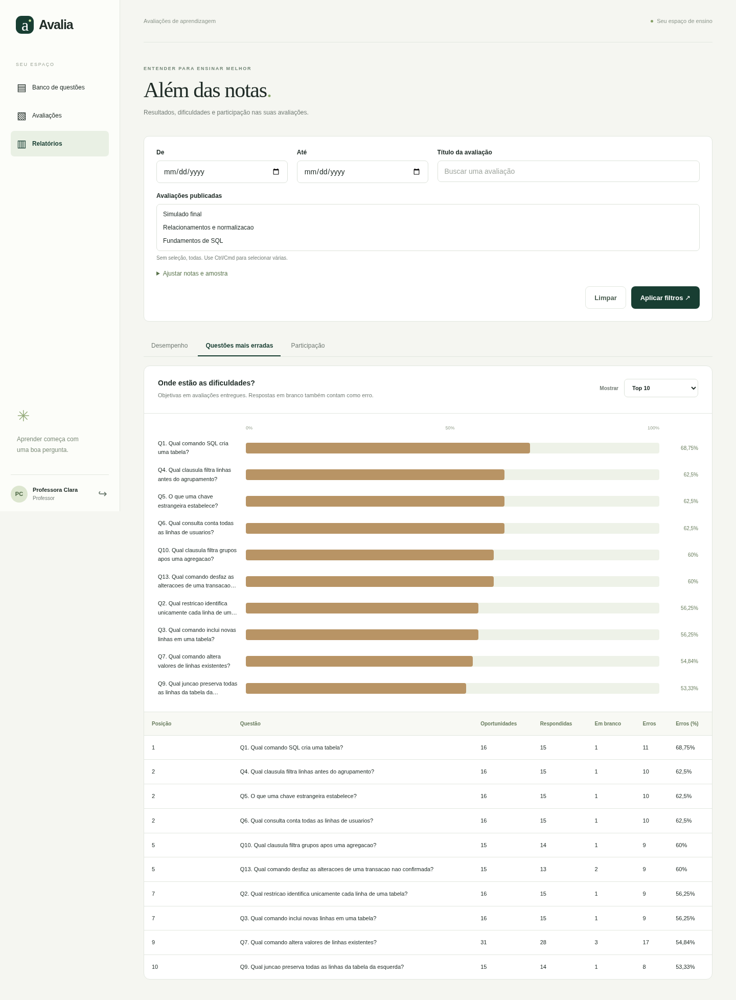
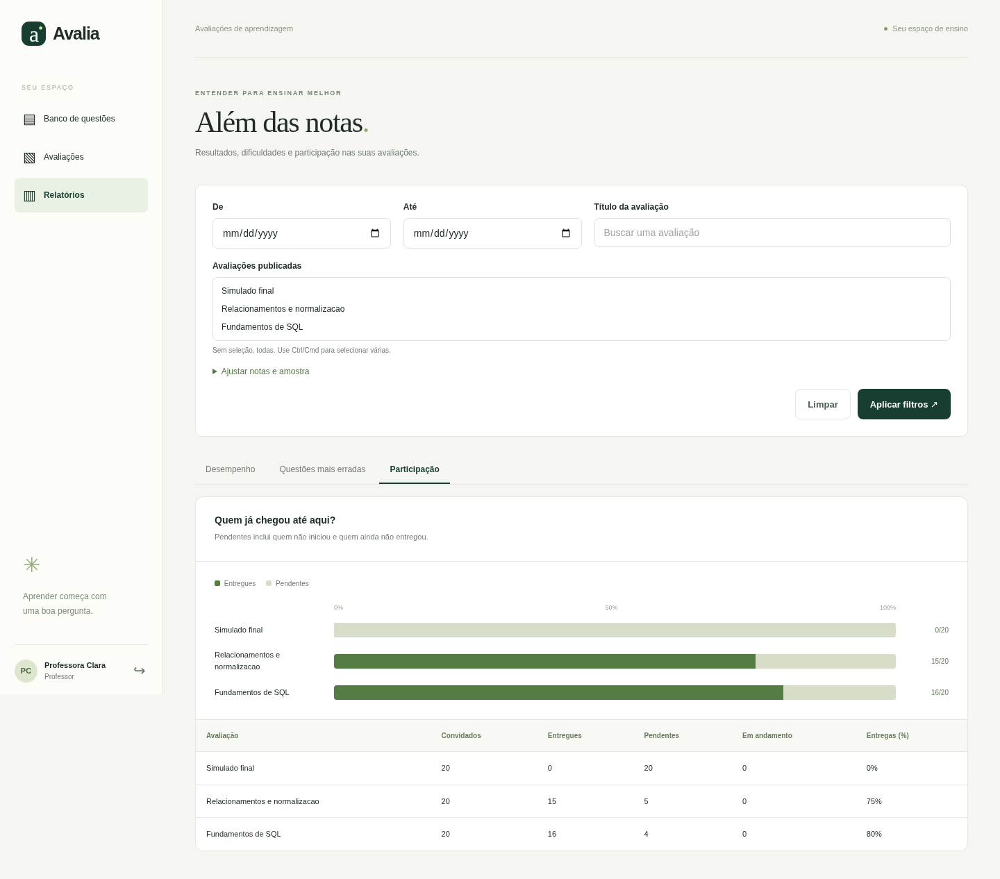

# Avalia: sistema de avaliação de aprendizagem

Trabalho 1 de Banco de Dados I, CDIA, Universidade Estadual de Londrina. Professor: Dr. Anderson Paulo Avila Santos.

**Integrantes:** Leonardo Madeira Alves Pereira e Gabriel Antônio Fabian Dors.

## Natureza e particularidade

O sistema permite cadastrar questões, montar provas e simulados, indicar alunos, registrar respostas e consultar resultados. Cada questão tem um valor específico dentro de cada avaliação. As objetivas são corrigidas automaticamente; as respostas de texto recebem nota do professor. O total por aluno é calculado a partir das notas de cada item.

Uma questão pode ser reutilizada em avaliações com valores diferentes. Cada aluno possui uma participação por avaliação, pode salvar e retomar respostas dentro do prazo e entrega sua tentativa para correção. Questões em branco valem zero. Uma correção textual pendente mantém o total final indisponível até a conclusão da correção.

## Funcionalidades

| Requisito | Implementação |
|---|---|
| RF1 | Cadastro de questões de múltipla escolha, com alternativas e gabarito, e de texto livre |
| RF2 | Avaliações com título, descrição, início, fim e situação de rascunho ou publicada |
| RF3 | Seleção e ordenação de questões existentes, com reutilização entre avaliações |
| RF4 | Seleção dos alunos participantes de cada avaliação |
| RF5 | Identificação por login e registro das respostas, com salvamento, retomada e entrega |
| RF6 | Valor por item, correção automática ou manual e total por aluno |
| RF7 | Três relatórios, cada um com tabela, gráfico e filtros |

O professor gerencia suas próprias avaliações, corrige textos e consulta os relatórios. O aluno acessa somente as avaliações destinadas a ele e os próprios resultados. A autorização é verificada pelo backend, incluindo bloqueio de alunos nos endpoints de relatórios. Avaliações publicadas ficam bloqueadas para edição.

## Tecnologias e organização

Java 21, Spring Boot 4.1.1, Maven Wrapper e PostgreSQL. O acesso ao banco usa DAOs JDBC com `JdbcTemplate` e `NamedParameterJdbcTemplate`, sem JPA ou Hibernate. O frontend usa HTML, CSS e JavaScript e é servido pela própria aplicação Java.

```text
backend/src/main/java/br/com/avaliacao/
├── api/              Controllers, DTOs e tratamento de erros
├── application/      Casos de uso e transações
├── domain/           Regras de negócio e contratos de persistência
└── infrastructure/   DAOs JDBC, segurança e configuração
frontend/             Telas, estilos e chamadas HTTP
database/             Schema, carga e consultas dos relatórios
docs/                 Modelagem e imagens
```

As gravações que envolvem várias tabelas são transacionais. SQL fica na infraestrutura de persistência; as consultas analíticas ficam em `database/relatorios.sql`, carregado como recurso pelos DAOs. Controllers e telas não acessam o banco diretamente.

## Modelo de dados

- [DER em imagem](docs/DER.png), com [versão SVG](docs/DER.svg) e [legenda](docs/DER.md).
- [Modelo Entidade Relacionamento](docs/MER.md).
- [Esquema relacional, chaves e justificativa de 3FN](docs/esquema.md).
- [DDL PostgreSQL](database/schema.sql).

Oito tabelas representam usuários, tipos de questão, questões, alternativas, avaliações, itens das avaliações, participações e respostas. O valor pertence a `avaliacao_questoes`, e a nota obtida pertence a `respostas`. A view `resultados_participacoes` calcula os totais e as pendências sem duplicar o total em uma coluna de participação.

## Como executar localmente

Os comandos abaixo usam Bash em Linux ou macOS. São necessários Git, JDK 21 e os clientes PostgreSQL (`psql` e `pg_isready`). Para o banco, usar Docker com daemon ativo ou uma instância PostgreSQL já instalada. A validação do projeto foi feita com PostgreSQL 17. O Maven Wrapper baixa o Maven e as dependências na primeira execução; não é necessário instalar Maven ou Node separadamente.

### 1. Clonar o repositório

```bash
git clone https://github.com/leonardo-madeira/sistema-avaliacao-aprendizagem.git
cd sistema-avaliacao-aprendizagem
java -version
```

Confirmar que o Java utilizado é o JDK 21. Se houver mais de uma versão instalada, ajustar `JAVA_HOME` e `PATH` para esse JDK.

### 2. Configurar a conexão

No mesmo terminal, escolher uma senha para o banco:

```bash
export DB_USER=avaliacao
read -r -s -p 'Senha do banco: ' DB_PASSWORD
printf '\n'
export DB_PASSWORD
export DB_URL=jdbc:postgresql://127.0.0.1:5432/avaliacao
export PGHOST=127.0.0.1
export PGPORT=5432
export PGUSER="$DB_USER"
export PGDATABASE=avaliacao
export PGPASSWORD="$DB_PASSWORD"
```

A senha do banco é independente da senha de login da aplicação. As variáveis precisam estar exportadas no terminal que iniciará o Java. A aplicação não carrega arquivos `.env` automaticamente.

### 3. Criar e iniciar um banco vazio

Com Docker, executar uma única vez para criar a instância:

```bash
docker volume create avalia-postgres-data
docker run --name avalia-postgres \
  -e POSTGRES_USER="$DB_USER" \
  -e POSTGRES_PASSWORD="$DB_PASSWORD" \
  -e POSTGRES_DB="$PGDATABASE" \
  -p 127.0.0.1:5432:5432 \
  -v avalia-postgres-data:/var/lib/postgresql/data \
  -d postgres:17
until pg_isready -h "$PGHOST" -p "$PGPORT" -U "$PGUSER" -d "$PGDATABASE"; do
  sleep 1
done
```

Nas próximas execuções, usar `docker start avalia-postgres`; o volume preserva os dados. Se já houver PostgreSQL na porta 5432, usar essa instância com um banco vazio de nome `avaliacao`, pertencente ao usuário configurado, ou escolher outra porta e ajustar `DB_URL`, `PGPORT` e o mapeamento do Docker. Em uma instalação nativa, criar o usuário e o banco com a ferramenta administrativa do PostgreSQL antes do próximo passo.

### 4. Executar schema e carga

Na raiz do repositório e sobre o banco vazio:

```bash
psql -v ON_ERROR_STOP=1 -f database/schema.sql
psql -v ON_ERROR_STOP=1 -f database/carga.sql
```

Executar nessa ordem, apenas na preparação inicial do banco. Os scripts não são migrações para reaplicar sobre dados existentes. O backend não cria tabelas nem carrega dados automaticamente.

A carga contém 22 usuários, sendo dois professores e vinte alunos, cinco avaliações, trinta questões, oitenta alternativas, cem participações e 608 respostas. Há avaliações sem entregas, tentativas em andamento, questões em branco e correções pendentes para demonstrar situações diferentes nos relatórios.

### 5. Configurar as contas de demonstração e iniciar

As contas da carga têm um marcador de senha ainda não configurada. Escolher uma senha de demonstração com pelo menos oito caracteres e no máximo 72 bytes:

```bash
read -r -s -p 'Senha de login para as contas de demonstracao: ' DEMO_PASSWORD
printf '\n'
export DEMO_PASSWORD
export CONFIGURAR_SENHAS_DEMO=true
cd backend
./mvnw spring-boot:run
```

A inicialização grava o hash da senha somente nas contas da carga que ainda têm o marcador. A mesma senha escolhida permite acessar essas contas. A configuração não redefine senhas que já foram inicializadas.

Abrir **http://127.0.0.1:8080/**. Não é necessário iniciar outro servidor para o frontend.

| Perfil | Email para entrar |
|---|---|
| Professora Clara | clara@example.test |
| Professor Rafael | rafael@example.test |
| Aluno de demonstração | aluno01@example.test |

Depois da primeira inicialização, parar com `Ctrl+C` e, nas próximas partidas, usar:

```bash
unset DEMO_PASSWORD CONFIGURAR_SENHAS_DEMO
./mvnw spring-boot:run
```

As senhas já gravadas continuam válidas. Ao abrir outro terminal, exportar novamente as variáveis de conexão do passo 2. Nenhuma senha ou token precisa ser colocado no código ou versionado.

### Alternativa: gerar o executável

Com as variáveis de conexão configuradas, dentro de `backend/`:

```bash
./mvnw -DskipTests package
java -jar target/avaliacao-backend-0.0.1-SNAPSHOT.jar
```

O JAR inclui o frontend e as consultas SQL dos relatórios. `SERVER_PORT` altera a porta HTTP, cujo padrão é 8080; `SERVER_ADDRESS` altera o endereço, cujo padrão é `127.0.0.1`.

## Percurso de demonstração

1. Entrar como professora e abrir o banco de questões. Cadastrar uma objetiva com gabarito e uma de texto livre.
2. Criar uma avaliação com início e fim que incluam o horário da demonstração, selecionar questões, atribuir valores e indicar o aluno `aluno01@example.test`.
3. Publicar a avaliação e sair. Entrar como aluno, responder e entregar a prova.
4. Voltar como professora, corrigir a resposta textual e consultar os relatórios.
5. Entrar como aluno para conferir a nota total após a correção.

A carga também permite abrir os relatórios imediatamente. Para realizar uma nova prova, criar uma avaliação no período atual, pois as datas da carga são fixas.

## Testes

Na pasta `backend/`, `./mvnw test` executa os testes de domínio. Os testes de integração são habilitados quando `TEST_DATABASE_URL` está definida.

Para integração, criar um banco **separado**, por exemplo `avaliacao_test`, com um usuário autorizado a criar e remover schemas, e executar:

```bash
export TEST_DATABASE_URL=jdbc:postgresql://127.0.0.1:5432/avaliacao_test
export TEST_DATABASE_USER="$DB_USER"
export TEST_DATABASE_PASSWORD="$DB_PASSWORD"
./mvnw test
```

Cada teste de integração prepara um schema isolado e o remove ao terminar. A validação realizada com PostgreSQL teve **72 testes aprovados**, cobrindo domínio, autenticação, autorização, cadastros, montagem, publicação, respostas, correção, transações e relatórios. As interfaces também foram verificadas em Chromium, em desktop e celular.

## Relatórios

Disponíveis para professores na opção **Relatórios**. Cada consulta é limitada às avaliações publicadas do professor autenticado. Os filtros comuns são período de início da avaliação, busca por título e seleção de avaliações. As datas são inclusivas e consideradas no fuso `America/Sao_Paulo`.

A fonte executada pelo backend é [database/relatorios.sql](database/relatorios.sql). As consultas abaixo são as mesmas seções desse arquivo. Os parâmetros `:nome` são vinculados pelo DAO JDBC; não são concatenados com valores fornecidos pelo usuário. Para executar as três consultas diretamente pelo cliente `psql`, na raiz e com a conexão do passo 2 configurada:

```bash
psql -v ON_ERROR_STOP=1 -f database/relatorios.sql
```

O cabeçalho define os parâmetros demonstrativos, incluindo professor de ID 1 e ausência de filtro de período. Na aplicação, o professor é obtido da sessão. As imagens abaixo mostram resultados da carga de demonstração.

### 1. Desempenho por avaliação

**Objetivo:** Comparar as médias e identificar avaliações com correções pendentes. A tabela mostra convidados, entregas, notas consideradas, pendências, média, pontuação máxima e notas extremas. O gráfico mostra a média percentual de cada avaliação e uma referência global ponderada pela quantidade de notas consideradas.

Só entram nas médias as entregas com correção concluída. Ausência de notas aparece como “Sem notas”; uma nota zero corrigida entra no cálculo. A faixa percentual e a quantidade mínima de notas filtram o desempenho sem alterar as contagens de convidados e entregas.



**Recursos SQL:** JOIN, LEFT JOIN, COUNT, AVG, SUM, MIN, MAX, GROUP BY, HAVING, subconsultas, ORDER BY e filtros por datas, faixa de notas, IN e LIKE.

<details>
<summary>Consulta SQL completa</summary>

```sql
WITH filtradas AS (
    SELECT a.id, a.titulo, a.inicio_em
    FROM avaliacoes a
    WHERE a.professor_id = :professorId AND a.status = 'PUBLICADA'
      AND (CAST(:inicio AS DATE) IS NULL OR CAST(a.inicio_em AT TIME ZONE 'America/Sao_Paulo' AS DATE) >= CAST(:inicio AS DATE))
      AND (CAST(:fim AS DATE) IS NULL OR CAST(a.inicio_em AT TIME ZONE 'America/Sao_Paulo' AS DATE) <= CAST(:fim AS DATE))
      AND LOWER(a.titulo) LIKE '%' || LOWER(COALESCE(:busca, '')) || '%'
      AND (:todasAvaliacoes OR a.id IN (:avaliacaoIds))
), dados AS (
    SELECT p.id, p.avaliacao_id, p.entregue_em, rp.nota_total,
           100.0 * rp.nota_total / NULLIF(rp.valor_total, 0) AS percentual
    FROM participacoes p
    JOIN filtradas f ON f.id = p.avaliacao_id
    JOIN resultados_participacoes rp ON rp.participacao_id = p.id
), resumo AS (
    SELECT f.id AS avaliacao_id, f.titulo, f.inicio_em,
           (SELECT COALESCE(SUM(aq.valor), 0) FROM avaliacao_questoes aq WHERE aq.avaliacao_id = f.id) AS valor_total,
           COUNT(d.id) AS convidados,
           COUNT(d.id) FILTER (WHERE d.entregue_em IS NOT NULL) AS entregues,
           COUNT(d.id) FILTER (WHERE d.entregue_em IS NOT NULL AND d.nota_total IS NULL) AS aguardando_correcao,
           COUNT(d.id) FILTER (WHERE d.percentual BETWEEN :notaMin AND :notaMax) AS notas_consideradas,
           AVG(d.nota_total) FILTER (WHERE d.percentual BETWEEN :notaMin AND :notaMax) AS media_nota,
           AVG(d.percentual) FILTER (WHERE d.percentual BETWEEN :notaMin AND :notaMax) AS media_percentual,
           MIN(d.nota_total) FILTER (WHERE d.percentual BETWEEN :notaMin AND :notaMax) AS menor_nota,
           MAX(d.nota_total) FILTER (WHERE d.percentual BETWEEN :notaMin AND :notaMax) AS maior_nota
    FROM filtradas f LEFT JOIN dados d ON d.avaliacao_id = f.id
    GROUP BY f.id, f.titulo, f.inicio_em
    HAVING COUNT(d.id) FILTER (WHERE d.percentual BETWEEN :notaMin AND :notaMax) >= :minimoCorrigidas
)
SELECT resumo.*,
       (SELECT SUM(r.media_percentual * r.notas_consideradas) / NULLIF(SUM(r.notas_consideradas), 0)
        FROM resumo r) AS media_geral_percentual
FROM resumo ORDER BY inicio_em DESC, avaliacao_id DESC;
```

</details>

### 2. Questões objetivas mais erradas

**Objetivo:** Identificar questões que merecem revisão pedagógica. A tabela mostra posição, questão, oportunidades, respostas registradas, questões em branco, erros e percentual de erros. O gráfico ordena as questões pela taxa de erro.

Uma oportunidade é a presença da questão em uma avaliação entregue por um aluno. Questões em branco contam como erro, e tentativas ainda não entregues ficam de fora. Se a questão for reutilizada, os dados são agregados entre as avaliações filtradas. Empates mantêm a mesma posição por RANK; o limite de linhas e a quantidade mínima de entregas são configuráveis.



**Recursos SQL:** JOIN, LEFT JOIN, COUNT, SUM, CASE, GROUP BY, HAVING, RANK, ORDER BY, FETCH FIRST e filtros por datas, IN e LIKE.

<details>
<summary>Consulta SQL completa</summary>

```sql
WITH filtradas AS (
    SELECT a.id FROM avaliacoes a
    WHERE a.professor_id = :professorId AND a.status = 'PUBLICADA'
      AND (CAST(:inicio AS DATE) IS NULL OR CAST(a.inicio_em AT TIME ZONE 'America/Sao_Paulo' AS DATE) >= CAST(:inicio AS DATE))
      AND (CAST(:fim AS DATE) IS NULL OR CAST(a.inicio_em AT TIME ZONE 'America/Sao_Paulo' AS DATE) <= CAST(:fim AS DATE))
      AND LOWER(a.titulo) LIKE '%' || LOWER(COALESCE(:busca, '')) || '%'
      AND (:todasAvaliacoes OR a.id IN (:avaliacaoIds))
), contagens AS (
    SELECT q.id AS questao_id, q.enunciado, COUNT(p.id) AS oportunidades,
           COUNT(r.id) AS respondidas, COUNT(p.id) - COUNT(r.id) AS em_branco,
           SUM(CASE WHEN r.id IS NULL OR r.nota_obtida = 0 THEN 1 ELSE 0 END) AS erros
    FROM filtradas f JOIN avaliacao_questoes aq ON aq.avaliacao_id = f.id
    JOIN questoes q ON q.id = aq.questao_id
    JOIN tipos_questao tq ON tq.id = q.tipo_questao_id AND tq.codigo = 'MULTIPLA_ESCOLHA'
    JOIN participacoes p ON p.avaliacao_id = f.id AND p.entregue_em IS NOT NULL
    LEFT JOIN respostas r ON r.participacao_id = p.id AND r.avaliacao_questao_id = aq.id
    GROUP BY q.id, q.enunciado
    HAVING COUNT(p.id) >= :minimoRespostas
), taxas AS (
    SELECT contagens.*, 100.0 * erros / oportunidades AS percentual_erros FROM contagens
)
SELECT RANK() OVER (ORDER BY percentual_erros DESC) AS posicao, taxas.*
FROM taxas ORDER BY percentual_erros DESC, erros DESC, questao_id
FETCH FIRST :limite ROWS ONLY;
```

</details>

### 3. Participação e pendências

**Objetivo:** Acompanhar o andamento das avaliações. A tabela mostra convidados, entregas, pendentes, tentativas em andamento e percentual de entregas. O gráfico empilhado compara entregues e pendentes em cada prova.

Pendentes incluem alunos que não começaram e os que ainda estão respondendo. Avaliações sem entregas ou participantes também aparecem; sem participantes, o percentual é indefinido e não é tratado como zero. A contagem é feita por participação, sem multiplicá-la pelo número de questões.



**Recursos SQL:** LEFT JOIN, COUNT, SUM, CASE, GROUP BY, ORDER BY, NULLIF e filtros por datas, IN e LIKE.

<details>
<summary>Consulta SQL completa</summary>

```sql
SELECT a.id AS avaliacao_id, a.titulo, a.inicio_em, COUNT(p.id) AS convidados,
       COALESCE(SUM(CASE WHEN p.entregue_em IS NOT NULL THEN 1 ELSE 0 END), 0) AS entregues,
       COUNT(p.id) FILTER (WHERE p.entregue_em IS NULL) AS pendentes,
       COUNT(p.id) FILTER (WHERE p.iniciada_em IS NOT NULL AND p.entregue_em IS NULL) AS em_andamento,
       100.0 * SUM(CASE WHEN p.entregue_em IS NOT NULL THEN 1 ELSE 0 END) / NULLIF(COUNT(p.id), 0) AS percentual_entregas
FROM avaliacoes a LEFT JOIN participacoes p ON p.avaliacao_id = a.id
WHERE a.professor_id = :professorId AND a.status = 'PUBLICADA'
  AND (CAST(:inicio AS DATE) IS NULL OR CAST(a.inicio_em AT TIME ZONE 'America/Sao_Paulo' AS DATE) >= CAST(:inicio AS DATE))
  AND (CAST(:fim AS DATE) IS NULL OR CAST(a.inicio_em AT TIME ZONE 'America/Sao_Paulo' AS DATE) <= CAST(:fim AS DATE))
  AND LOWER(a.titulo) LIKE '%' || LOWER(COALESCE(:busca, '')) || '%'
  AND (:todasAvaliacoes OR a.id IN (:avaliacaoIds))
GROUP BY a.id, a.titulo, a.inicio_em
ORDER BY a.inicio_em DESC, a.id DESC;
```

</details>

### Cobertura dos recursos exigidos

| Recurso | Relatórios que demonstram o uso |
|---|---|
| Junção interna | Desempenho e questões mais erradas |
| Junção externa | Os três relatórios |
| COUNT, AVG, SUM e GROUP BY | Desempenho; contagens adicionais em erros e participação |
| HAVING | Desempenho e questões mais erradas |
| Subconsulta | Desempenho, incluindo referência global ponderada |
| Ordenação e ranking | ORDER BY nos três; RANK e FETCH FIRST em questões mais erradas |
| Datas, faixas, IN e LIKE | Período, faixa de notas, avaliações selecionadas e busca por título |
