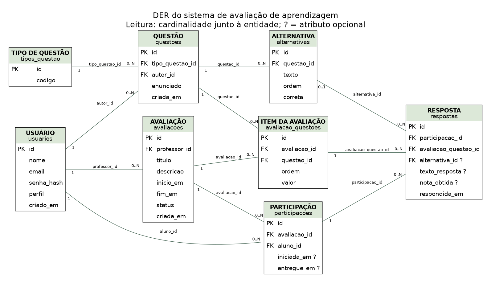
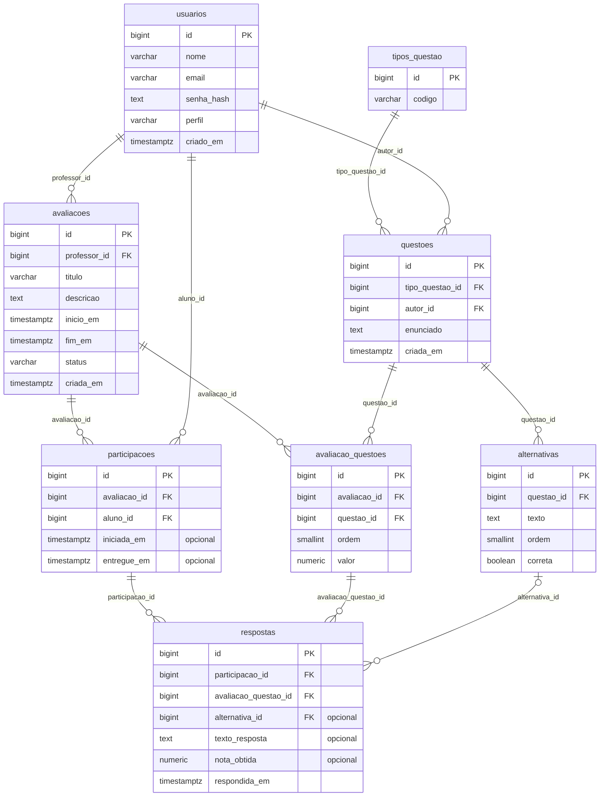

# Diagrama Entidade Relacionamento

O modelo possui oito entidades e onze chaves estrangeiras, conforme [schema.sql](../database/schema.sql). A pontuação pertence ao item da avaliação; a nota obtida pertence à resposta.

[Versão vetorial SVG](DER.svg) · [Esquema relacional e 3FN](esquema.md) · [Modelo conceitual](MER.md)

## Legenda

PK é chave primária e FK é chave estrangeira. `?` indica atributo que aceita NULL. Em cada ligação, a cardinalidade fica junto à entidade correspondente: `1` significa exatamente um, `0..1` significa opcional e `0..N` significa zero ou muitos. Cada filho exige um pai, exceto Resposta → Alternativa, que é opcional para permitir respostas textuais.

O diagrama mostra as tabelas implementadas, com FKs visíveis. Os conceitos, nomes dos relacionamentos e regras de negócio estão no [MER](MER.md).

## Diagrama em Mermaid

